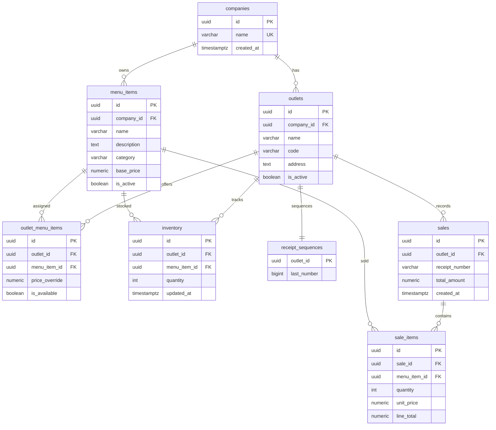

# Architecture Documentation

This document satisfies the **architecture documentation** deliverable: database ERD, scaling plan for 10 outlets / 100k transactions per month, microservices evolution, and offline POS + KDS strategy.

## Table of contents

1. [ERD](#erd-entity-relationship-diagram)
2. [Layered application architecture](#layered-application-architecture)
3. [Scaling plan (10 outlets · 100k txn/month)](#scaling-plan-10-outlets--100000-transactions--month)
4. [Conversion to microservices](#conversion-to-microservices)
5. [Offline POS mode strategy](#offline-pos-mode-strategy)

---

## ERD (Entity Relationship Diagram)



### Key constraints
- Unique `(company_id, name)` on master menu items
- Unique `(outlet_id, menu_item_id)` on assignments and inventory
- Unique `(outlet_id, receipt_number)` on sales
- `CHECK (quantity >= 0)` on inventory prevents negative stock at DB level
- Receipt numbers are generated via atomic upsert on `receipt_sequences` inside a DB transaction

---

## Layered Application Architecture

```
React UI
   ↓ HTTP /api
Express Routes → Controllers → Services → Repositories → PostgreSQL
```

| Layer | Responsibility |
|---|---|
| Routes | Path mapping + input validation |
| Controllers | HTTP request/response shaping |
| Services | Business rules (stock checks, assignment rules, sales orchestration) |
| Repositories | SQL / data access |
| Middleware | Validation errors, 404, centralized error handler |

---

## Scaling Plan (10 Outlets · ~100,000 transactions / month)

~100k sales/month ≈ 3.3k/day ≈ ~2–4 writes/minute average, with lunch/dinner spikes. This volume is modest for a single well-tuned Postgres instance, but the design should evolve deliberately.

### Database scaling strategies
1. **Vertical first**: larger Postgres instance, connection pooling (`PgBouncer`), tuned `shared_buffers` / `work_mem`.
2. **Partitioning**: partition `sales` / `sale_items` by month (`created_at`) once historical data grows.
3. **Read replicas**: route HQ reporting queries to a replica; keep POS writes on primary.
4. **Indexes**: already present on `(outlet_id, created_at)`, sale item FKs, inventory keys — monitor with `pg_stat_statements`.
5. **Archive cold data**: move sales older than N months to object storage / analytics warehouse.

### Reporting performance
1. Materialized views for daily revenue and top items, refreshed every 5–15 minutes.
2. Pre-aggregate into `daily_outlet_stats` via scheduled job (cron / worker).
3. Avoid scanning raw `sale_items` for dashboards during peak hours.
4. Cache report responses in Redis with short TTL for HQ dashboards.

### Infrastructure considerations
1. Stateless API behind a load balancer (2+ replicas).
2. Separate deploy units for API and web (already dockerized).
3. Health checks + structured logs + metrics (request latency, stock conflict rate, sale TPS).
4. Managed Postgres with automated backups and PITR.
5. Rate-limit public endpoints; keep POS LAN traffic trusted.

### Architectural evolution
| Stage | Shape |
|---|---|
| Now | Modular monolith (this repo) |
| Growth | Add Redis cache + report worker |
| Scale | Split read models / CQRS for reports |
| Large | Extract domain services (see microservices section) |

---

## Conversion to Microservices

The current modular monolith is the right starting point. Boundaries for later extraction:

| Service | Owns | Why separate |
|---|---|---|
| **Catalog Service** | `menu_items`, `outlet_menu_items` | Menu changes are HQ-driven and cache-friendly; independent deploy cadence |
| **Inventory Service** | `inventory` | High contention on stock; can specialize locking / reservation |
| **Sales / POS Service** | `sales`, `sale_items`, `receipt_sequences` | Latency-critical write path; outlet-local scaling |
| **Reporting Service** | read models / warehouse | Heavy analytics without impacting POS |
| **Outlet / Org Service** | `companies`, `outlets` | Low churn master data |

### Integration approach
- Sync commands via REST/gRPC within a VPC initially
- Async events (`SaleCompleted`, `StockUpdated`, `MenuAssigned`) over a message bus (Kafka/NATS) for reporting and inventory projections
- Outbox pattern on the sales DB to guarantee event publish with the sale transaction
- Keep a shared OpenAPI contract and correlation IDs across services

Do **not** split early — extract only when team/ownership or scaling pressure justifies the operational cost.

---

## Offline POS Mode Strategy

### Goals
1. POS continues taking orders without internet
2. Kitchen Display System (KDS) keeps receiving tickets on the local network
3. When online again, sales sync to HQ without duplicate receipts or negative stock races

### Local runtime
- Each outlet runs a **local POS gateway** (lightweight Node service or embedded SQLite/Postgres)
- POS terminals and KDS communicate over **LAN** (WebSocket / local HTTP), never requiring HQ for ticket flow
- Local store holds: assigned menu snapshot, current inventory snapshot, pending sales queue

### Offline sale flow
1. Cashier creates sale → local transaction assigns a **local receipt id** (`LOCAL-{outlet}-{seq}`)
2. Stock deducted in local inventory store (reject if local stock insufficient)
3. Ticket pushed to KDS over LAN
4. Sale marked `pending_sync`

### Sync on reconnect
1. Device/gateway uploads pending sales in FIFO order with idempotency key = local receipt id
2. HQ API endpoint `POST /sync/sales` validates menu assignment + applies inventory with optimistic/pessimistic locking
3. On success HQ returns canonical `receipt_number` (`R-00000042`); local store maps local→HQ receipt
4. Conflicts:
   - **Insufficient HQ stock**: flag for manager review; do not silently drop the sale — keep local record + conflict status
   - **Duplicate idempotency key**: return existing HQ sale (safe retry)
5. After sync, pull fresh menu + inventory snapshot from HQ

### Ensuring POS ↔ KDS while offline
- Both devices discover the local gateway via mDNS or configured outlet IP
- KDS subscribes to local order events; no cloud dependency
- Heartbeat between POS gateway and KDS; if gateway restarts, replay undelivered tickets from durable local queue

### Data safety
- Encrypted local DB at rest
- Automatic retry with exponential backoff
- Audit log of sync attempts for HQ reconciliation reports
